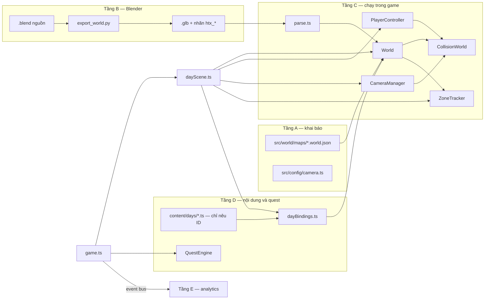

# S2_EXECUTION_BLUEPRINT — bản đồ, va chạm, điều khiển, camera A/B, pipeline Blender

Lập 15/11/2026 (tối) sau khi audit thật repo. Nhánh `feature/s2-world-camera-blender`, tách từ `dev` @ `4f681cb`.
Người đọc: Claude Opus (làm tiếp) và chủ dự án (duyệt). Đi kèm: `docs/PROMPT_FOR_OPUS.md`.

## 0. Điều quan trọng nhất

**Phần code của S2 ĐÃ CÓ và đang chạy trên nhánh này.** Việc còn lại là kiểm chứng trên trình duyệt, viết tài liệu, rồi xin chủ dự án duyệt gộp vào `dev`. **Không dựng lại từ đầu, không viết lại hệ thống đang chạy.**

Mọi mô tả dưới đây lấy từ code tại thời điểm lập. Nếu tài liệu này lệch với code thì **code đúng**; sửa tài liệu.

## 1. Kết quả audit (chạy thật, 15/11 22:10–22:20, UTC+7)

| Kiểm | Kết quả |
|---|---|
| `npx tsc --noEmit` | đạt |
| `npm test` (vitest) | 217 đạt, 1 bỏ qua (test Firestore, vì Emulator không bật) |
| `npm run validate:world` | đạt — 6 khu, 0 lỗi, 0 nhắc |
| `tools/blender/world/tests/test_pipeline.py` | 61/61 trên Blender 4.5.16 LTS và 61/61 trên 5.2.4 LTS (gói `bpy` cài bằng pip, Linux) |
| 6 file `.blend` trong repo | mở được bằng 4.5.16, lưu bởi 4.5, 0 lỗi quy ước, trạng thái "chưa ai sửa tay" |
| `npm run test:e2e` (Chrome headless) | 13 đạt, 1 bỏ qua (cần Emulator). Bot chơi hết 2 Ngày trên bản đồ mới |
| `VERCEL_ENV=production npm run build` | đạt; bản production không chứa công cụ test |

**Chưa kiểm** (đây chính là việc còn lại, xem §6):
- Chưa có test trình duyệt riêng cho S2: đi bộ đụng tường, đi bộ qua ranh khu, đổi camera A ↔ B, khóa con trỏ kiểu B, khu đóng có chặn thật không. Các thứ này mới được kiểm ở mức unit test.
- Chưa chạy lại phần Firestore Emulator sau khi có S2.
- Chưa xem ảnh kết xuất từ Blender để so màu với trong game.
- Chưa chạy bằng `blender.exe` trên máy Windows của chủ dự án (mới chạy bằng gói `bpy` trên Linux).
- FPS trên laptop thật; trình duyệt Edge.

### Hai nơi chứa repo — đừng nhầm
| Nơi | Trạng thái |
|---|---|
| GitHub `KusaThaor/GAME-KNDMST` | `main` @ `4adf991`, `dev` @ `4f681cb` (F0–F10), `feature/asset-workshop` @ `cb5e51d` (Antigravity), `feature/s2-world-camera-blender` (nhánh này) |
| Máy chủ dự án `C:\Users\Admin\Desktop\GAME\GAME-KNDMST` | Đang ở nhánh `feature/asset-workshop` (khu vực của Antigravity). **Chưa có** code F1–F10 lẫn S2 (lần fetch cuối 14/11). Có thư mục riêng `blender/` (bàn ghế, nhân vật mẫu) và `assets/` (`school_desk.glb`, `vietnamese_student.glb`) — thuộc nhánh Antigravity, không thuộc S2 |

Làm S2 trên máy đó thì **không đổi nhánh trong thư mục ấy**. Tạo thư mục làm việc riêng:
```
git fetch origin
git worktree add ..\GAME-KNDMST-s2 feature/s2-world-camera-blender
cd ..\GAME-KNDMST-s2 && npm ci
```

## 2. Đã chốt trong tài liệu thiết kế và đang tạm

### 2.1 Sáu khu (nguồn: GDD v0.3 §4 — bản đồ `map_thcs`, một bản đồ liền, không màn tải giữa các khu)
| GDD | ID khu (ổn định) | File nguồn / file game | Đi thẳng tới | Điểm tương tác đang có |
|---|---|---|---|---|
| Z01 Lớp học | `zone.thcs.classroom` | `zone_classroom.blend` / `.glb` | corridor | `itr.thcs.blackboard`, `itr.thcs.wall_news` |
| Z02b Hành lang + mái hiên + rãnh nước | `zone.thcs.corridor` | `zone_corridor` | classroom, yard | `itr.thcs.gutter` |
| Z02 Sân trường | `zone.thcs.yard` | `zone_yard` | corridor, gate | `stone_bench`, `flagpole`, `duty_spot`, `shuttle_ring`, `tripod_spot`; máy ảnh `cam.thcs.yard_bench`, `cam.thcs.yard_group` |
| Z03 Cổng + ngõ quà vặt | `zone.thcs.gate` | `zone_gate` | yard, field | `itr.thcs.snack_cart`, `itr.thcs.grocery` |
| Z04 Bãi đất trống | `zone.thcs.field` | `zone_field` | gate, base | `itr.thcs.marble_spot` |
| Z05 Căn cứ bí mật | `zone.thcs.base` | `zone_base` | field | `itr.thcs.old_table`, `itr.thcs.base_shelf` |

File nguồn nằm ở `tools/blender/world/map_thcs/`, file game ở `public/assets/world/map_thcs/`. Mỗi khu có 1 điểm xuất hiện `spawn.thcs.<slug>`. Bản đồ này không dùng portal (đi bộ liền); portal chỉ có ở khu thử thứ 7 trong test.

- **CHỐT (từ GDD):** danh sách và tên 6 khu; bản đồ liền; ranh giới phải có lý do trong cảnh.
- **TẠM:** vị trí, kích thước, hình khối từng khu. GDD chưa có bản vẽ mặt bằng nên bố cục là blockout do Fable tự đặt (khoảng 86 × 66 m; GDD ghi "khoảng 110 × 80 m"). Tham số bố cục gom ở đầu `tools/blender/world/gen_map_thcs.py` (biến `L`).
- **TẠM:** khu nào mở ở Ngày nào (`open_zones` trong `src/content/days/*.ts`, nội dung giả). Khu không mở bị chặn bằng vật có nhãn `htx_gate_zone` dựng sẵn trong Blender.

### 2.2 Camera A/B (nguồn: GDD v0.3 §3)
Cả hai đều là **camera thứ ba** bám sau nhân vật, nhìn chéo xuống 25–40°, cách 5,5 m (phóng 3,5–8 m), tự kéo gần khi bị che. Khác nhau ở cách xoay:
- **A:** giữ chuột phải rồi rê.
- **B:** khóa con trỏ, rê chuột là xoay, Esc để thả.

Master prompt S2 có ghi phương án dự phòng "A = góc nhìn thứ nhất, B = thứ ba" **chỉ dùng khi tài liệu không có đặc tả**. Tài liệu có đặc tả nên phương án đó **không được dùng**. Muốn có góc nhìn thứ nhất là thay đổi thiết kế, cần chủ dự án quyết.

Phím: `V` đổi A ↔ B. `C` để dành cho máy ảnh cầm tay/cuộn phim (chưa làm, không gán việc khác). Phòng 2026 vẫn là góc cố định.

### 2.3 Quyết định liên quan
| Mã | Nội dung | Trạng thái | Nằm ở đâu trong code |
|---|---|---|---|
| D-S2-01 | Kiểu camera mặc định cho người chơi mới | **CHƯA CHỐT** — đang để A | `DEFAULT_CAMERA_MODE` trong `src/config/camera.ts` |
| D-S2-02 | Bố cục 6 khu | **CHƯA CHỐT** — blockout tạm | `gen_map_thcs.py` + 6 file `.blend` |
| D-S2-03 | Khu nào mở ở Ngày nào | **CHƯA CHỐT** — nội dung giả | `open_zones` trong `src/content/days/*.ts` |
| D-S2-04 | Art style | **CHƯA KHÓA** — mặc định toon + viền | `DEFAULT_ART_STYLE` trong `src/render/style.ts`; bảng màu ở `tools/blender/world/palettes/` |
| D-S2-05 | Blender chuẩn của dự án: GDD ghi 5.2 LTS, máy chủ dự án cài 4.5.16 LTS | **CẦN CHỐT** — pipeline chạy được cả hai; file `.blend` hiện lưu bằng 4.5 | `BLENDER_TESTED` trong `pipeline_config.py` |
| D-01, D-04, D-12, D-13, D-19, D-20 | (xem `OPEN_DECISIONS_REGISTER_v1`) | **CHƯA CHỐT** — đang dùng phương án khuyến nghị làm giá trị tạm trong `src/content/` và `src/config/` | không đổi trong S2 |
| D-03 | Phạm vi bản public 05–15/12 | **CHƯA CÓ CÂU TRẢ LỜI** — danh sách production để trống | `src/content/release.ts` |

S2 không tự chốt quyết định nào ở bảng trên.

## 3. Kiến trúc đang có (5 tầng)



| Tầng | File | Vai trò |
|---|---|---|
| A | `src/world/maps/<map>.world.json` | Manifest viết tay: danh sách khu, file, đường nối, điểm xuất hiện mặc định, preset camera |
| A | `src/world/maps/<map>.index.json` | Bảng tóm tắt marker **sinh tự động** (`npm run world:index`). Không sửa tay |
| A | `src/world/maps/index.ts` | Sổ bản đồ: tự gom mọi file `*.world.json` trong thư mục. Thêm bản đồ không cần sửa code |
| A | `src/config/camera.ts` | Preset camera, kiểu A/B, độ nhạy chuột, bảng phím |
| A | `src/config/game.ts` | Tốc độ đi/chạy, bán kính tương tác |
| B | `tools/blender/world/pipeline_config.py` | **Nơi duy nhất** khai quy ước phía Blender |
| B | `tools/blender/world/htx_world.py` | Thư viện: dựng khối, gắn nhãn, kiểm quy ước, xuất GLB, nhận biết file đã sửa tay |
| B | `gen_map_thcs.py` · `export_world.py` · `new_zone.py` | Sinh blockout · xuất lại GLB (không bao giờ sửa `.blend`) · tạo file khởi đầu cho khu mới |
| B | `tools/blender/world/palettes/*.json` | Bảng màu, tách khỏi hình khối |
| C | `src/world/types.ts` | Mọi kiểu dữ liệu của hệ thế giới |
| C | `src/world/parse.ts` | Đọc một GLB theo nhãn `htx_*` → phần nhìn, sàn, vật cản, marker, ranh khu, portal |
| C | `src/world/world.ts` | `loadWorld()`, lớp `World`, `buildWorldIndex()` |
| C | `src/world/collision.ts` | Va chạm hộp/tròn trên mặt bằng + tia chắn camera. Không dùng physics engine |
| C | `src/world/travel.ts` | `ZoneTracker`: đổi khu, portal |
| C | `src/world/validate.ts` | Kiểm manifest, index và tham chiếu từ nội dung |
| C | `src/actors/player/controller.ts`, `avatar.ts` | Đi lại + va chạm; lớp bọc hình nhân vật (thay model không đụng controller) |
| C | `src/actors/camera/cameraManager.ts` | Bám theo, tránh che, khóa/trả cho cutscene và khung ngắm |
| C | `src/game/input.ts` | Một bộ listener duy nhất; kiểu rê chuột và kiểu khóa con trỏ |
| C | `src/render/style.ts` | Phong cách hình ảnh (`toon_outline`, `soft_pbr`), tách khỏi bản đồ |
| D | `src/world/dayBindings.ts` | Đổi ID trong nội dung (marker) ra tọa độ. Đây là lớp nối duy nhất giữa nội dung và hình học |
| D | `src/game/scenes/dayScene.ts` | Ráp `World` + controller + camera + tracker cho một Ngày. Không chứa tọa độ, tên mesh hay phím |
| D | `src/game/game.ts` | Luồng game; gọi `buildDayScene`, lưu khu đang đứng, đổi kiểu camera |
| E | `src/analytics/bridge.ts` | Chỉ thêm `zone_entered {memory_day_id, zone_id}`. Kiểu camera chỉ lưu cục bộ, không gửi đi |

Code cũ còn giữ: `src/world/school/yardCorner.ts` chỉ còn phục vụ trang thử `?lab=yard`. Không xóa khi chưa kiểm ai còn dùng.

### Tên file trong yêu cầu ↔ file thật trong repo
| Yêu cầu | File thật | Lý do |
|---|---|---|
| `src/game/world/worldManifest.ts` | `src/world/maps/map_thcs.world.json` + kiểu `WorldManifest` trong `src/world/types.ts` | Repo theo cấu trúc GDD §12 (`src/world/`). Manifest là JSON để script Blender đọc chung một file. Không tạo thêm bản `.ts` để tránh hai nguồn sự thật |
| `scripts/blender/pipeline_config.py` | `tools/blender/world/pipeline_config.py` | Repo đặt script Blender ở `tools/blender/` (GDD §12); `scripts/` là script Node |
| Tiền tố `INTERACT_` | Chuẩn là `ITR_` (khớp ID `itr.<map>.<slug>`); `INTERACT_` được nhận như tên gọi khác | Khai ở `pipeline_config.py` và `src/world/types.ts` |

## 4. Hợp đồng (interface) — nguồn sự thật là file được nêu

### 4.1 Manifest và marker (`src/world/types.ts`)
```ts
interface ZoneDef { id: string; asset: string; source: string; connections: string[]; camera_preset?: string; offset?: [number, number, number] }
interface WorldManifest { schema: 1; map_id: string; title: string; asset_root: string; default_spawn: string; camera_preset: string; zones: ZoneDef[] }
type MarkerKind = 'spawn' | 'interact' | 'spot' | 'camera' | 'target' | 'portal' | 'zone' | 'trigger';
interface Marker { id: string; kind: MarkerKind; zone: string; position: [number, number, number]; facing: number; radius?: number; props: Record<string, string | number | boolean> }
interface Portal { id: string; zone: string; region: Region; targetSpawn: string; activate: 'enter' | 'interact'; label: string | null }
interface WorldProblem { level: 'error' | 'warn'; code: string; zone?: string; ref?: string; message: string }
```
`connections` phải khai hai chiều. `asset_root` bắt đầu và kết thúc bằng `/`.

### 4.2 Phần chạy
```ts
// src/world/world.ts
loadWorld(manifest, { openZones?, decorSet?, style?, fetchAsset?, merge? }): Promise<World>   // ném WorldLoadError nếu thiếu file
class World { root; problems; loadedZones; portals;
  find(id): Marker | null; spawn(id?): Marker | null; spawnInZone(zone): Marker | null;
  zoneAt(x, z): string | null; ground(x, z, y?): number | null; portalsAt(x, z): Portal[];
  setViewerZone(zone): void; addColliders(extra): void; dispose(): void }
// src/world/collision.ts
class CollisionWorld { resolve(x, z, y, body?): { x; z; hit }; blocked(x, z, y, body?): boolean; segmentHit(a, b, pad?, cameraOnly?): number | null }
// src/actors/player/controller.ts
class PlayerController { state: 'idle' | 'walk' | 'run'; teleport(x, z, facing?, y?); update(dt, intent: MoveIntent | null, cameraYaw) }
// src/actors/camera/cameraManager.ts
class CameraManager { camera; setPreset(p); snapBehind(facing, target); lock(pose); release(); update(dt, target, look: LookInput | null) }
// src/game/input.ts
interface GameInput { held(action); takeLook(); setLookMode('drag' | 'lock'); releasePointer(); setLockGuard(fn); onLockChange(fn); listenerCount; dispose() }
// src/game/scenes/dayScene.ts
buildDayScene(day, idx, gender, { style?, startZone?, fetchAsset? }): Promise<DayScene>
interface DayScene { zone; onZoneChange; problems; placeholder; update(dt, t, ctl); teleport(); toSpawn(id?); portalPrompt(); usePortal();
  standSpot(); setStandZone(); cameraFor(point); lockCamera(point | null); allInFrame(); setGizmosVisible(); debug(); dispose() }
```
`DayScene.placeholder = true` nghĩa là không nạp được bản đồ và game đang dùng mặt bằng tạm (không sập).

### 4.3 Nội dung tham chiếu bản đồ thế nào (`src/content/types.ts`)
Nội dung của Ngày ký ức **không ghi tọa độ**, chỉ nêu ID:
```ts
{ actor: 'NPC_A', marker: 'spot.thcs.yard_bench_1' }                 // NPC đứng ở marker SPOT_
{ id: 'itr.thcs.stone_bench', label: '…', zone_id: 'zone.thcs.yard' }  // vị trí = marker ITR_ cùng ID
{ id: 'cam.d0601.bench', marker: 'cam.thcs.yard_bench', fov: 42 }      // điểm nhìn = marker '<marker>.target'
stand_zone: { marker: 'spot.thcs.yard_group', radius: 1.1 }
```
`npm run validate:world` báo lỗi nếu nội dung nêu ID mà bản đồ không có.

### 4.4 Quy ước Blender (`tools/blender/world/pipeline_config.py`)
- Mỗi khu là 1 file `.blend`, đặt sẵn đúng vị trí trong bản đồ. 1 đơn vị = 1 mét. Trục game: x = X, y = Z, z = −Y.
- Collection: `ENVIRONMENT`, `ARCHITECTURE`, `PROPS`, `COLLISION`, `ZONE_BOUNDS`, `INTERACTION_MARKERS`, `SPAWN_MARKERS`, `PORTAL_MARKERS`, `LIGHTING`.
- Ý nghĩa gameplay nằm ở **custom property của object**: `htx_kind` (loại) và `htx_id` (ID ổn định). Exporter bật `export_extras`, game đọc ở `userData`. Đã kiểm bằng test trên cả hai bản Blender.
- **Không dùng tên object làm ID**: Blender tự thêm `.001` khi trùng tên, Three.js bỏ dấu chấm trong tên.
- Object chưa có `htx_kind` thì exporter tự điền theo tiền tố tên: `COLLIDER_`, `FLOOR_`, `SPAWN_`, `ITR_` (hoặc `INTERACT_`), `SPOT_`, `CAM_`, `TARGET_`, `PORTAL_`, `ZONE_`, `TRIGGER_`.
- Object không có nhãn là phần để nhìn: sửa, xóa, thêm thoải mái mà không ảnh hưởng gameplay.
- Thiếu `htx_id` ở loại bắt buộc → exporter báo lỗi và **không ghi file**.
- Bản đối ứng phía game ở `src/world/types.ts`. Sửa một bên phải sửa cả bên kia (chưa có test tự động so hai bên — xem §6, Chặng 1).

## 5. Quy trình Blender (đã chạy thật bằng gói `bpy`; lệnh `blender.exe` chưa chạy trên máy Windows)

```
# Sửa bản đồ: mở file trong tools/blender/world/map_thcs/, sửa, lưu. Rồi xuất lại:
blender --background --python tools/blender/world/export_world.py -- --zones yard
npm run world:index
npm run validate:world
npm test

# Chỉ kiểm quy ước, không ghi file:
blender --background --python tools/blender/world/export_world.py -- --check-only
# Ảnh xem thử (Cycles CPU) vào tools/blender/world/map_thcs/previews/:
blender --background --python tools/blender/world/export_world.py -- --preview
# Tạo file khởi đầu cho khu mới (không ghi đè file đã có, không sửa manifest):
blender --background --python tools/blender/world/new_zone.py -- --zone zone.thcs.annex --rect 60,-6,72,6 --exit-to spawn.thcs.field --entry-at 49.5,0
```
Trên Windows, `blender` thường là `"C:\Program Files\Blender Foundation\Blender 4.5\blender.exe"` (đường dẫn mặc định, chưa xác minh trên máy chủ dự án). Không có Blender cài sẵn thì dùng Python 3.11 + `pip install bpy==4.5.*` và thay `blender --background --python X -- …` bằng `python X …`.

An toàn cho file đã sửa tay: `gen_map_thcs.py` ghi dấu vân tay lúc sinh file; file có dấu khác bị coi là **đã sửa tay** và không bị ghi đè, kể cả với `--force`. Chỉ `--overwrite-edited` mới ghi đè, và tự sao lưu vào `backups/` trước. Sau khi đã sửa tay, **chỉ dùng `export_world.py`**.

## 6. Việc còn lại — chia 3 chặng

Nguyên tắc chung: không sửa hệ thống đang chạy nếu chưa có test chỉ ra lỗi. Sửa lỗi thì viết test tái hiện trước.

### Chặng 1 — World & Blender Pipeline
| Việc | File |
|---|---|
| Chạy lại toàn bộ kiểm ở §1 làm mốc | — |
| Kết xuất ảnh xem thử 6 khu, **mở ảnh ra nhìn**, so màu với ảnh chụp trong game | lệnh `--preview`; ghi kết quả vào `S2_TEST_REPORT.md` |
| Test so quy ước hai phía (Python ↔ TypeScript) | TẠO `tests/unit/world/conventions.test.ts` — đọc `pipeline_config.py` dạng chữ, so `NAME_PREFIX_KIND` và `KINDS_NEED_ID` với `src/world/types.ts` |
| Nếu có Blender thật trên máy: chạy `test_pipeline.py` bằng `blender.exe` | ghi kết quả |
| Tài liệu | TẠO `docs/BLENDER_PIPELINE.md`, `docs/HOW_TO_EXPAND_WORLD.md` (làm theo đúng các bước của test "khu thứ 7": `tests/unit/world/expand.test.ts` và mục 7 của `test_pipeline.py`) |

Không sửa: `gen_map_thcs.py` (bố cục chờ D-S2-02), 6 file `.blend`.

### Chặng 2 — Controller & Camera
| Việc | File |
|---|---|
| Test trình duyệt cho S2, dùng chuột và bàn phím thật | TẠO `tests/e2e/world.spec.ts` |
| Nếu test lộ lỗi: sửa nhỏ, đúng chỗ | có thể SỬA `src/actors/player/controller.ts`, `src/actors/camera/cameraManager.ts`, `src/game/input.ts`, `src/world/collision.ts`, `src/game/scenes/dayScene.ts` |
| Tài liệu | TẠO `docs/S2_WORLD_ARCHITECTURE.md` (mở rộng §3–§4 của file này), `docs/DECISIONS_AND_OPEN_QUESTIONS.md` (từ §2.3) |

`world.spec.ts` cần có ít nhất các ca sau (dựng trên `window.__game`: `state()`, `teleport()`, `toSpawn()`, `world()` trong `src/lab/gameTools.ts`):
1. Giữ `W` đi thẳng vào tường → vị trí dừng lại, không xuyên.
2. Đi bộ từ sân qua hành lang → `state().zone` đổi, tên khu hiện ra, có đúng 1 event `zone_entered` cho khu mới.
3. Ngày chỉ mở 3 khu (`d.g06.01`): đi về phía cổng → bị chặn, `zone` không thành `zone.thcs.gate`.
4. Bấm `V` → kiểu camera đổi A ↔ B, nhãn trên màn hình đổi; tải lại trang vẫn giữ kiểu đã chọn.
5. Kiểu A: giữ chuột phải rê → góc xoay đổi; không giữ thì không đổi. Lăn chuột → khoảng cách đổi trong giới hạn preset.
6. Kiểu B: khóa con trỏ khi đang đi; mở thoại hoặc bảng thì con trỏ được thả. (Chrome headless có thể không hỗ trợ khóa con trỏ — nếu vậy ghi rõ là chưa kiểm được, không giả kết quả.)
7. Đứng sát tường, xoay camera ra sau tường → khoảng cách camera thật nhỏ hơn khoảng cách đặt.
8. Bước chụp ảnh hẹn giờ: camera bị khóa ở khung ngắm rồi được trả lại sau khi chụp.
9. Phòng → Ngày → phòng 3 vòng: `state().listeners` không tăng.
10. Tải lại trang khi đang đứng ở khu khác khu xuất phát → đứng lại ở điểm xuất hiện của khu đó, tiến độ quest giữ nguyên.

### Chặng 3 — Integration & Test
| Việc | File |
|---|---|
| Chạy đủ bộ có Firestore Emulator (cách bật: `docs/DEV_SESSION_HANDOFF.md`, mục Lưu ý) | — |
| Build production + kiểm không lọt công cụ test | — |
| Ảnh chụp trong game cho cả 6 khu, cả 2 phong cách (`?play=1&style=soft_pbr`) | lưu vào `shots/` (không đưa vào Git) |
| Tài liệu | TẠO `docs/ART_STYLE_CHANGE_GUIDE.md`, `docs/S2_TEST_REPORT.md`, `docs/AI_HANDOFF_START_HERE.md`; SỬA `README.md` (mục bản đồ, phím, lệnh `world:*`), `docs/DEV_SESSION_HANDOFF.md` |
| Xin chủ dự án duyệt gộp vào `dev` | mở Pull Request `feature/s2-world-camera-blender` → `dev`. **Không tự gộp. Không đụng `main`.** |

### Không làm trong S2
Cốt truyện/thoại thật; chốt bất kỳ quyết định D-xx nào; nối nhân vật `vietnamese_student.glb` của nhánh Antigravity (việc riêng, đi qua `rigAvatar` trong `src/actors/player/avatar.ts`); sửa `tools/asset-workshop/`; cuộn phim (phím C); minigame; form phản hồi; physics engine.

## 7. Bảng nghiệm thu S2 (trạng thái lúc lập)

| Tiêu chí | Trạng thái | Bằng chứng / còn thiếu |
|---|---|---|
| Có 6 khu theo tài liệu, blockout ghi chú rõ | ĐẠT | `validate:world`; §2.1 |
| Các khu nạp được | ĐẠT | `world.test.ts`; bot đi tới điểm tương tác ở cả 6 khu |
| Đi lại được | ĐẠT một phần | unit + test giữ `W`; thiếu ca 1 |
| Đường nối/đổi khu | ĐẠT một phần | `travel.test.ts`; thiếu ca 2, 3 trên trình duyệt |
| Thêm khu bằng cấu hình + file | ĐẠT (mức unit) | `expand.test.ts` + mục 7 `test_pipeline.py`; thiếu tài liệu |
| Camera A, B, đổi kiểu | ĐẠT một phần | `camera.test.ts`; thiếu ca 4, 5, 6 |
| Camera không xuyên vật | ĐẠT một phần | unit; thiếu ca 7 |
| Va chạm | ĐẠT một phần | `collision.test.ts`, `controller.test.ts`; thiếu ca 1 |
| Input không nhân đôi | CHƯA KIỂM trên trình duyệt | thiếu ca 9 |
| `.blend` sửa được + `.glb` tương ứng + script xuất + collection | ĐẠT | §1 |
| Màu Blender ↔ game | CHƯA KIỂM | Chặng 1 |
| Giữ ID ổn định sau khi sửa phần nhìn | ĐẠT | mục 4 `test_pipeline.py` |
| Luồng cũ, quest, checkpoint, phòng 2026 | ĐẠT | Playwright 13 đạt |
| Analytics, đồng ý thu thập | ĐẠT một phần | chưa chạy lại phần Emulator |
| Hướng dẫn sửa Blender, thêm khu, đổi art style, đổi model | CHƯA CÓ | Chặng 1–3 |
| Preset camera chỉnh trong cấu hình | ĐẠT | `src/config/camera.ts` |
| Quest không dính tên mesh/file | ĐẠT | nội dung chỉ nêu ID; `validate:world` |

## 8. Rủi ro và lưu ý

- **Hai bản quy ước** (Python và TypeScript) có thể lệch nhau cho tới khi có test ở Chặng 1.
- **Thay hình khối lớn** (dời tường, đổi kích thước sân) thì phải sửa cả khối `COLLIDER_`, `FLOOR_`, `ZONE_` tương ứng. Va chạm không tự sinh từ phần nhìn — đó là chủ ý, để đổi phần nhìn không làm hỏng gameplay.
- Vật cản bị nghiêng (xoay quanh X/Y) được game coi là hộp thẳng trục; exporter có nhắc.
- `map_thcs.index.json` phải sinh lại sau mỗi lần xuất GLB, nếu không `validate:world` báo `index_stale`.
- Đẩy nhánh lên GitHub có thể làm Vercel tạo bản preview cho nhánh đó. Đó không phải production.
- Chrome headless vẽ bằng CPU: không dùng làm số đo FPS.
- Máy chủ dự án: không đổi nhánh trong thư mục đang ở `feature/asset-workshop`.
