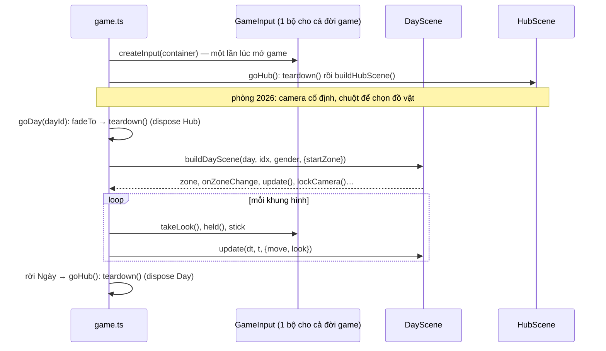

# S2_WORLD_ARCHITECTURE — bản đồ, điều khiển, camera chạy thế nào

Lập 16/11/2026 (phiên 2c). Mở rộng §3–§4 của `docs/S2_EXECUTION_BLUEPRINT.md`: blueprint nói **file nào làm gì**, file này nói **chúng chạy với nhau ra sao**.
Nguồn sự thật luôn là code; chỗ nào lệch thì code đúng, sửa lại file này.

## 1. Năm tầng, một câu mỗi tầng
| Tầng | Một câu | File chính |
|---|---|---|
| A — khai báo | Bản đồ có khu nào, preset camera, phím, độ nhạy — tất cả là số trong file cấu hình | `src/world/maps/*.world.json`, `src/config/camera.ts`, `src/config/game.ts` |
| B — Blender | Dựng/sửa khu trong `.blend`, xuất ra `.glb` có nhãn `htx_*` | `tools/blender/world/` |
| C — chạy | Đọc `.glb` → sàn, vật cản, marker, ranh khu; nhân vật đi, camera bám | `src/world/`, `src/actors/`, `src/game/input.ts`, `src/game/gestures.ts` |
| D — nội dung | Ngày ký ức chỉ nêu **ID** (`zone.*`, `itr.*`, `spot.*`, `cam.*`, `spawn.*`), không tọa độ | `src/content/days/*.ts`, `src/world/dayBindings.ts` |
| E — đo lường | Chỉ thêm `zone_entered {memory_day_id, zone_id}`; kiểu camera/thiết bị không gửi đi | `src/analytics/bridge.ts` |

## 2. Vòng đời một cảnh (phòng 2026 ↔ Ngày ký ức)



- **Listener chỉ gắn một lần** (`createInput` trong `game.ts`). Scene không tự gắn listener nên vào/ra bao nhiêu lần cũng không nhân đôi. Kiểm bằng e2e ca 9 (đếm cả số game tự báo lẫn listener thật trên `window`/`document` qua DevTools).
- `teardown()` gọi `dispose()` của scene cũ: gỡ hình, vật liệu, texture. `GameInput.dispose()` chỉ chạy khi đóng game hẳn, gỡ sạch cả listener cảm ứng.
- **Tải lại trang:** khu đang đứng được lưu (`save.current.zone_id`, lưu mỗi lần đổi khu). Mở lại → `buildDayScene({ startZone })` đặt người chơi ở điểm xuất hiện (`SPAWN_`) của khu đó, nếu khu đó còn mở. Tiến độ quest do checkpoint lo (không đổi). Kiểm bằng e2e ca 10.

## 3. Đổi khu và cổng chặn
- `ZoneTracker` (`src/world/travel.ts`) so vị trí với các khối ranh `ZONE_`. Bước qua ranh → `onZoneChange` → `game.ts`: hiện tên khu (toast), đổi preset camera nếu khu có preset riêng, ghi `zone_entered` **một lần cho mỗi khu trong một lượt vào Ngày**, yêu cầu lưu.
- Khu không mở trong Ngày (`open_zones`) bị chặn bằng vật cản có `htx_gate_zone` — vật này chỉ được nạp khi khu đó đóng. Ca 3: `d.g06.01` mở 3 khu, đi về cổng trường bị chặn ở ranh.

## 4. Camera (`CameraManager`)
- Một camera thứ ba dùng chung cho mọi khu. Số lấy từ preset (`CAMERA_PRESETS`): khoảng cách 5,5 m (zoom 3,5–8 m, theo GDD), góc nghiêng mặc định 30° (trong nhà 38°).
- **Góc nghiêng 5–65°** (`CAMERA_PITCH_RANGE`, chủ dự án chốt 16/11 tối để kéo lên/xuống thấy rõ như Play Together/PUBG). Số GDD cũ 25–40° (trong nhà 28–52°) giữ ở `CAMERA_PITCH_GDD_V03` làm dự phòng.
- **Tránh bị che:** mỗi khung hình dò đoạn thẳng từ đầu nhân vật tới camera trên dữ liệu va chạm (`segmentHit`, chỉ vật có `blocksCamera`). Bị che → kéo gần ngay; hết che → lùi ra từ từ. Không cho gần hơn 0,6 m. Ca 7.
- **Khóa/trả cho cutscene và khung ngắm:** `lockCamera(point)` → `CameraManager.lock(pose)` nhớ góc xoay, góc nghiêng, khoảng cách, fov đang có rồi đặt camera cố định; `lockCamera(null)` → `release()` trả đúng các số đó. Gọi `lock` nhiều lần vẫn nhớ trạng thái ban đầu. Trong lúc khóa, kéo chuột/chạm không xoay.
  - Ảnh hẹn giờ: khóa ở khung ngắm khi hiện bảng "Bấm hẹn giờ"; bấm xong trả lại camera thứ ba để chạy vào vòng sáng (ca 8).
  - `cancelAll()` (rời Ngày, làm lại Ngày…) luôn gọi `lockCamera(null)` để không kẹt camera.
- Khi có thoại/bảng mở, `game.ts` truyền `look = null` → camera vẫn bám nhân vật nhưng không xoay.

## 5. Đầu vào: chuột / touchpad / cảm ứng → nhân vật và camera

```mermaid
flowchart LR
  subgraph Thiết bị
    MS[Chuột: kéo trái/phải, lăn]
    TP[Touchpad: kéo 1 ngón, vuốt 2 ngón ngang/dọc, chụm]
    TC[Cảm ứng: ngón trên vùng trống, chụm 2 ngón]
    KB[Bàn phím: WASD, Shift, E…]
    ST[Nút tròn nổi — TouchControls.tsx]
  end
  subgraph input.ts — một bộ listener
    PE[Pointer Events trên khung chơi]
    WH[wheel → WheelRouter]
    LG[LookGestures: kéo hay bấm? chụm?]
  end
  MS --> PE
  TP --> PE
  TP --> WH
  TC --> PE
  PE --> LG
  KB --> HELD[held / onKey]
  ST -- setStick --> STICK[stick]
  LG --> LOOK[takeLook: dx, dy, zoom]
  WH --> LOOK
  LOOK --> CAM[CameraManager.update]
  HELD --> MOVE[ý định đi]
  STICK --> MOVE
  MOVE --> CTL[PlayerController.update — đi theo hướng camera]
  CTL --> COL[CollisionWorld.resolve]
```

| Thao tác | Ra kết quả gì | Logic ở đâu |
|---|---|---|
| Kéo chuột trái/phải trên chỗ trống | Xoay ngang + nghiêng. Quá 6 px mới tính kéo; bấm nhanh vẫn là bấm vào vật/NPC. Bấm trên nút giao diện không xoay | `LookGestures` + `ButtonDrag` (giữ con trỏ khi kéo ra ngoài khung) |
| Lăn chuột · touchpad vuốt 2 ngón dọc · chụm (wheel + ctrlKey) | Lại gần/ra xa, trong giới hạn preset; trang không bị phóng | `WheelRouter`, `wheelZoomSteps` |
| Touchpad vuốt 2 ngón **ngang** (không nhấn) | Xoay ngang — tay kia vẫn giữ WASD | `WheelRouter` (mỗi lần vuốt chỉ một hướng) |
| Cảm ứng: kéo một ngón ở chỗ trống | Xoay (nhanh hơn chuột ×1,4) | `LookGestures` |
| Cảm ứng: 2 ngón trên chỗ trống | Chụm để phóng (không xoay) | `LookGestures.pinchPair` |
| Cảm ứng: chạm bất kỳ đâu ở **vùng góc trái dưới** | Nút tròn hiện dưới ngón tay ("nổi"), kéo để đi, sát mép = chạy; thả tay nút về chỗ cũ | `TouchStick` + `floatingStickCenter`, `joystickVector` |
| Nút tròn + ngón khác kéo xoay cùng lúc | Chạy song song (mỗi ngón theo `pointerId`) | |

Mọi ngưỡng/độ nhạy ở `POINTER_INPUT` và `LOOK_SENSITIVITY` (`src/config/camera.ts`) — chỉnh số, không sửa code.
`GameInput.device` (`'keyboard' | 'touch'`) đổi theo thao tác gần nhất để giao diện hiện đúng hướng dẫn; không gửi vào analytics.

**Code dự phòng (không xóa):** kiểu A (giữ chuột phải), kiểu B (khóa con trỏ), "Nhìn tự do", nút tròn cố định (`joystick.floating = false`). Đang tắt theo chốt 16/11 "chỉ dùng camera Chuẩn"; bật lại ở `CAMERA_OPTIONS` / `POINTER_INPUT`.

## 6. Thay model nhân vật qua `rigAvatar`
- Bộ điều khiển, camera, ảnh chụp chỉ làm việc qua giao diện `Avatar` (`src/actors/player/avatar.ts`): `root` (đặt ở chân, mặt nhìn +z), `height`, `setMotion(motion, speed)`, `motion`, `update(dt)`.
- Hiện có một adapter: `rigAvatar(rig)` cho nhân vật dựng bằng code.
- Muốn dùng model GLB có xương (ví dụ nhân vật của nhánh Asset Workshop): viết một hàm mới, ví dụ `gltfAvatar(gltf)`, trả đúng giao diện `Avatar` (map `idle/walk/run` sang clip animation), rồi đổi chỗ tạo avatar trong `dayScene.ts`. Không phải sửa `PlayerController`, `CameraManager` hay nội dung. Việc này chưa làm trong S2.

## 7. Thêm khu / sửa bản đồ
Xem `docs/HOW_TO_EXPAND_WORLD.md` và `docs/BLENDER_PIPELINE.md`. Nhắc lại hai điều hay quên: va chạm không tự sinh từ phần nhìn (phải sửa `COLLIDER_`/`FLOOR_`/`ZONE_`), và chạy `npm run world:index` sau mỗi lần xuất GLB.
